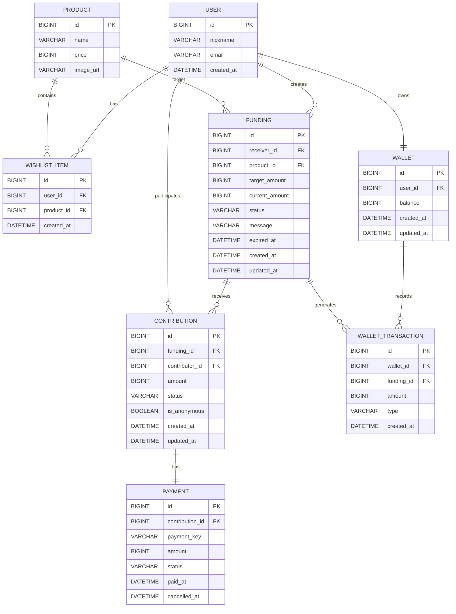

# 🎁 Gift Together

> 여러 사람이 하나의 위시리스트 상품에 금액을 나누어 참여하는 공동 선물 펀딩 서비스

기존 선물하기 서비스에서는 고가의 선물을 선물하려면 한 사람이 상품 금액 전체를 부담해야 합니다.

Gift Together는 위시리스트에 등록된 하나의 상품에 여러 사용자가 원하는 금액만큼 참여하여 함께 선물할 수 있도록 만든 서비스입니다.

예를 들어 150,000원짜리 상품에 세 명의 친구가 각각 30,000원, 50,000원, 70,000원을 참여하면 목표 금액이 달성되고 펀딩이 완료됩니다.

---

## 💡 기획 배경

생일이나 기념일에 받고 싶은 상품이 있어도 가격이 높으면 한 명의 친구가 전체 금액을 부담하기 어렵습니다.

이를 해결하기 위해 다음과 같은 공동 선물 방식을 설계했습니다.

```text
150,000원 상품

친구 A  30,000원
친구 B  50,000원
친구 C  70,000원
────────────────
총      150,000원
        ↓
   펀딩 목표 달성 🎉
```

단순 금액 모금에서 끝나는 것이 아니라 위시리스트 상품, 결제, 펀딩 상태, 환불, 마감 후 잔액 처리까지 하나의 선물 흐름으로 구현하는 것을 목표로 했습니다.

---

## ✨ 주요 기능

### 위시리스트 기반 펀딩 생성

- 사용자는 자신의 위시리스트에 등록된 상품으로만 펀딩을 생성할 수 있습니다.
- 목표 금액은 클라이언트가 전달하지 않고 서버가 상품 가격을 기준으로 결정합니다.
- 펀딩 생성 시점의 상품 가격을 목표 금액으로 고정합니다.

### 공동 선물 참여

- 여러 사용자가 하나의 펀딩에 원하는 금액만큼 참여할 수 있습니다.
- 최소 참여 금액은 1,000원입니다.
- 한 사용자가 여러 번 참여할 수 있습니다.
- 남은 목표 금액을 초과하여 참여할 수 없습니다.
- 목표 금액에 도달하면 펀딩 상태가 자동으로 `COMPLETED`로 변경됩니다.

### 익명 참여

- 참여자는 익명 여부를 선택할 수 있습니다.
- 익명 참여도 서버 내부에서는 참여자를 식별하지만 조회 API에서는 사용자 ID와 닉네임을 노출하지 않습니다.

### 결제 및 취소

현재 실제 PG 대신 Mock Payment를 사용합니다.

- 결제 성공 / 실패 상태 관리
- 결제 실패 시 펀딩 금액 미반영
- 진행 중인 펀딩에서 본인의 참여 취소 가능
- 펀딩 생성자가 전체 펀딩을 취소하면 완료된 참여 금액 환불

### 펀딩 마감 및 Wallet

목표 금액을 달성하지 못하고 마감된 경우 참여 금액을 자동 환불하지 않고 선물을 받는 사용자의 Wallet로 전달합니다.

이는 참여 금액 자체가 수신자에게 전달하려던 선물이라는 서비스 정책을 반영한 것입니다.

- `OPEN → EXPIRED`
- 현재까지 모인 금액을 수신자 Wallet에 적립
- WalletTransaction을 통해 적립 내역 기록
- 중복 적립 방지를 고려한 만료 처리

---

## 🔥 핵심 기술 과제: 동시성 제어

### 1. 문제 상황

Gift Together에서는 여러 사용자가 하나의 펀딩에 동시에 참여할 수 있습니다.

처음에는 일반적인 조회 후 금액을 갱신하는 방식으로 구현했지만, 동시에 여러 요청이 들어오면 각 트랜잭션이 동일한 `currentAmount`를 읽을 수 있다는 문제가 있었습니다.

예를 들어 목표 금액이 100,000원인 펀딩에 여러 사용자가 동시에 10,000원씩 참여하면 다음과 같은 상황이 발생할 수 있습니다.

```text
Transaction A ─┐
Transaction B ─┼─→ 동일한 currentAmount 조회
Transaction C ─┘
                     ↓
              각각 참여 가능 여부 판단
                     ↓
              동시에 금액 갱신
```

단순히 애플리케이션에서

```java
if (amount > remainingAmount) {
    throw new BadRequestException("남은 금액을 초과할 수 없습니다.");
}
```

와 같이 검증하는 것만으로는 동시 요청에 대한 데이터 정합성을 보장할 수 없었습니다.

---

### 2. 동시성 문제 재현

동시성 테스트를 작성하여 다음 조건으로 100개의 요청을 동시에 발생시켰습니다.

```text
목표 금액       100,000원
요청 수         100개
요청당 참여 금액  10,000원

기대 결과
성공             10개
실패             90개
최종 금액        100,000원
상태             COMPLETED
```

동시성 제어가 없는 상태에서는 여러 트랜잭션이 동일한 값을 읽고 갱신하면서 최종 금액이 기대값과 일치하지 않는 문제를 재현했습니다.

---

### 3. 원인 분석

참여 로직은 다음 과정을 수행합니다.

```text
Funding 조회
    ↓
현재 상태 확인
    ↓
남은 금액 계산
    ↓
참여 가능 여부 검증
    ↓
currentAmount 증가
```

이 과정의 `조회 → 검증 → 갱신`이 하나의 트랜잭션 안에 있더라도 다른 트랜잭션의 동시 접근 자체를 막지는 못합니다.

따라서 동일한 Funding에 대한 참여 요청을 순차적으로 처리할 수 있는 동시성 제어가 필요했습니다.

---

### 4. 해결 — Pessimistic Lock

Funding을 조회할 때 JPA의 `PESSIMISTIC_WRITE` 락을 적용했습니다.

```java
@Lock(LockModeType.PESSIMISTIC_WRITE)
@Query("select f from Funding f where f.id = :fundingId")
Optional<Funding> findByIdWithLock(@Param("fundingId") Long fundingId);
```

참여 요청은 해당 Funding의 락을 획득한 트랜잭션부터 처리됩니다.

```text
Request A ──→ Funding Lock 획득 ──→ 검증 ──→ 금액 변경 ──→ Commit
Request B ──→        대기         ──→ Lock 획득 ──→ 검증 ──→ ...
Request C ──→        대기
```

따라서 각 요청은 이전 요청이 반영된 최신 `currentAmount`를 기준으로 남은 금액을 다시 계산합니다.

이를 통해 목표 금액을 초과하는 참여를 방지했습니다.

---

### 5. 실제 PostgreSQL 환경에서 검증

동시성 문제는 데이터베이스의 Lock 동작과 직접 관련되므로 H2 테스트만으로 끝내지 않고 Testcontainers를 사용하여 PostgreSQL 환경에서도 검증했습니다.

```java
@Container
static PostgreSQLContainer<?> postgres =
        new PostgreSQLContainer<>("postgres:16-alpine")
                .withDatabaseName("gift_together_test")
                .withUsername("test")
                .withPassword("test");
```

100개의 동시 참여 요청을 실행한 결과:

```text
성공 요청       10
실패 요청       90

최종 모금액     100,000원
남은 금액       0원
펀딩 상태       COMPLETED
```

목표 금액을 초과하지 않으면서 정확히 10개의 요청만 성공하는 것을 확인했습니다.

---

### 6. 왜 비관적 락을 선택했는가?

이 서비스에서는 하나의 인기 펀딩에 여러 사용자의 참여 요청이 짧은 시간에 집중될 수 있고, 결제 금액을 다루기 때문에 데이터 정합성이 중요합니다.

충돌이 발생한 뒤 재시도하는 방식보다 동일한 Funding의 변경을 순차적으로 처리하는 방식이 현재 프로젝트의 규모와 요구사항에 적합하다고 판단하여 비관적 락을 적용했습니다.

향후 서비스가 확장되어 다중 인스턴스 환경이나 높은 트래픽을 처리해야 한다면 락 범위와 트랜잭션 시간을 최소화하고, 분산 락이나 별도의 동시성 처리 구조도 검토할 수 있습니다.


## 🖥 Frontend 구현

Next.js와 TypeScript를 활용하여 공동 선물 펀딩의 주요 사용자 흐름을 웹 UI로 구현했습니다.

### 주요 화면

| 경로 | 기능 |
|---|---|
| `/` | 서비스 소개 및 메인 화면 |
| `/wishlist` | 위시리스트 상품 조회 |
| `/fundings/new` | 펀딩 생성 |
| `/fundings` | 내 펀딩 목록 및 상태별 필터 |
| `/fundings/{fundingId}` | 펀딩 상세, 진행률 및 참여 내역 |
| `/fundings/{fundingId}/contribute` | 펀딩 참여 및 익명 여부 선택 |
| `/wallet` | 모의 지갑 잔액 및 적립 내역 |

### 사용자 경험 개선

- 펀딩 상태에 따라 참여·취소 버튼 노출 제어
- 마감 시간이 지난 펀딩의 참여·취소 UI 차단
- 브라우저 공유 API를 이용한 펀딩 공유
- 클립보드 API를 이용한 링크 복사
- 펀딩 목록의 상태별 필터링
- API 로딩 및 오류 상태 처리

### 구현 범위

현재 프론트엔드는 Mock 사용자 ID를 사용하며,
실제 로그인·결제·카카오톡 연동은 구현하지 않았습니다.

공유 기능은 웹 브라우저의 공유 API를 사용합니다.
카카오톡 전용 공유 SDK와는 별개입니다.

## 🛠 Tech Stack

### Frontend

- Next.js 16
- React
- TypeScript
- Tailwind CSS

### Backend

- Java 17
- Spring Boot 3.5
- Spring MVC
- Spring Data JPA
- Gradle

### Database

- PostgreSQL
- H2 (일부 테스트)

### Test

- JUnit 5
- Spring Boot Test
- Testcontainers
- PostgreSQL Container

### Documentation

- Springdoc OpenAPI
- Swagger UI

---

## 🗃 ERD



### 관계 설명

- `User`는 여러 개의 위시리스트 상품을 가질 수 있습니다.
- `User`는 위시리스트 상품을 기반으로 `Funding`을 생성합니다.
- 하나의 `Funding`에는 여러 `Contribution`이 참여할 수 있습니다.
- 각 `Contribution`은 하나의 `Payment`와 연결됩니다.
- `User`는 하나의 `Wallet`을 가지며, 펀딩 만료 시 적립 내역을 `WalletTransaction`으로 기록합니다.

## 🏗 프로젝트 구조

```text
com.gifttogether
├── common
│   └── exception
├── config
├── contribution
│   ├── controller
│   ├── domain
│   ├── dto
│   ├── repository
│   └── service
├── funding
│   ├── controller
│   ├── domain
│   ├── dto
│   ├── repository
│   ├── scheduler
│   └── service
├── payment
│   ├── domain
│   └── repository
├── product
│   ├── domain
│   └── repository
├── user
│   ├── domain
│   └── repository
├── wallet
│   ├── controller
│   ├── domain
│   ├── dto
│   ├── repository
│   └── service
└── wishlist
    ├── controller
    ├── domain
    ├── dto
    ├── repository
    └── service
```

---

## 🔄 펀딩 상태

```text
             목표 금액 달성
OPEN ─────────────────────→ COMPLETED
 │
 │ 마감 시간 도달
 ↓
EXPIRED

OPEN ───── 생성자 취소 ───→ CANCELLED
```

| 상태 | 설명 |
|---|---|
| `OPEN` | 참여 가능한 펀딩 |
| `COMPLETED` | 목표 금액 달성 |
| `EXPIRED` | 목표 금액 미달 상태로 마감 |
| `CANCELLED` | 생성자가 펀딩 취소 |

---

## 📌 주요 비즈니스 정책

| 정책 | 내용 |
|---|---|
| 펀딩 생성 | 본인 위시리스트의 상품만 가능 |
| 목표 금액 | 펀딩 생성 시점의 상품 가격 |
| 최소 참여 | 1,000원 |
| 중복 참여 | 동일 사용자 여러 번 참여 가능 |
| 초과 참여 | 남은 목표 금액 초과 불가 |
| 익명 참여 | 조회 시 참여자 정보 비공개 |
| 목표 달성 | 자동 `COMPLETED` |
| 참여 취소 | `OPEN` 상태에서 본인 참여만 가능 |
| 펀딩 취소 | 생성자만 가능하며 참여 금액 환불 |
| 목표 미달 마감 | 모인 금액을 수신자 Wallet에 적립 |

---

## 📡 API

Swagger UI를 통해 API 명세 및 테스트가 가능합니다.

| Method | Endpoint | Description |
|---|---|---|
| `GET` | `/api/wishlist` | 위시리스트 조회 |
| `POST` | `/api/fundings` | 펀딩 생성 |
| `GET` | `/api/fundings/my` | 내 펀딩 목록 조회 |
| `GET` | `/api/fundings/{fundingId}` | 펀딩 상세 조회 |
| `POST` | `/api/fundings/{fundingId}/cancel` | 펀딩 취소 |
| `POST` | `/api/fundings/{fundingId}/contributions` | 펀딩 참여 |
| `GET` | `/api/fundings/{fundingId}/contributions` | 참여 내역 조회 |
| `POST` | `/api/fundings/{fundingId}/contributions/{contributionId}/cancel` | 참여 취소 |
| `GET` | `/api/wallet` | Wallet 조회 |
| `GET` | `/api/wallet/transactions` | Wallet 적립 내역 조회 |

보호 API에는 `POST /api/auth/login`의 `accessToken`을 Bearer 토큰으로 보냅니다.

```bash
curl -H "Authorization: Bearer ${ACCESS_TOKEN}" http://127.0.0.1:8080/api/wishlist
```

`dev` 프로파일의 Swagger에서는 **Authorize**에 로그인에서 받은 토큰을 입력합니다.

---

펀딩 마감 시각 `expiredAt`은 API와 데이터베이스에서 시간대 오프셋이 없는
`LocalDateTime`을 사용하며, 한국 시간(`Asia/Seoul`)으로 해석합니다.
예를 들어 `2026-12-01T18:00:00`은 한국 시간 18시이고 UTC 09시입니다.
생성 요청에 `Z`, `+09:00` 등의 오프셋을 포함하면 `400 BAD_REQUEST`를 반환합니다.
기존 OPEN 펀딩은 배포 전에 [읽기 전용 점검 안내](docs/open-funding-deadline-audit.md)를 참고하세요.
참여, 본인 참여 취소, 펀딩 전체 취소는 마감 시각 직전까지 가능하며,
마감 정각부터는 만료 스케줄러가 아직 실행되지 않았어도 서버가 거절합니다.

## 🧪 테스트

비즈니스 규칙뿐 아니라 API, 예외 처리, 스케줄러 및 동시성 상황을 테스트합니다.

```text
ExceptionHandlingTest
ContributionCancelApiTest
ContributionConcurrencyTest
ContributionPaymentFailureTest
ContributionQueryTest
FundingContributionTest
FundingDeadlineTest
FundingDetailApiTest
FundingExpirationSchedulerTest
FundingExpirationTest
WalletApiTest
WishlistApiTest
```

특히 다음 경계 상황을 검증합니다.

- 최소 참여 금액 미만 요청
- 남은 금액 초과 참여
- 목표 금액 정확히 달성
- 완료된 펀딩 추가 참여 차단
- 마감 시간 직전 / 정확한 마감 시각
- 결제 실패 시 펀딩 금액 미반영
- 다른 펀딩의 참여 내역 취소 방지
- 익명 참여자 정보 비공개
- 펀딩 만료 후 Wallet 적립
- 100개 동시 참여 요청에서 데이터 정합성 유지

전체 테스트:

```bash
./gradlew test
```

> `ContributionConcurrencyTest`는 Testcontainers를 사용하므로 Docker 호환 런타임이 필요합니다.

마감 시각 테스트는 UTC 서버에서도 실행할 수 있습니다.

```bash
TZ=UTC ./gradlew test --tests '*FundingDeadline*' --tests '*FundingExpirationSchedulerTest'
cd frontend
TZ=UTC node --test tests/deadline.test.mjs
```

---

## 📖 API Documentation

`dev` 프로파일로 실행하면 Swagger UI와 OpenAPI JSON을 확인할 수 있습니다. 기본 및 `prod` 프로파일에서는 두 기능이 비활성화됩니다.

```text
http://localhost:8080/swagger-ui/index.html
```

OpenAPI JSON:

```text
http://localhost:8080/v3/api-docs
```

---

## 🚀 Local Run

### 백엔드

Java 17과 PostgreSQL을 준비합니다. [환경변수 예시](.env.example)를 참고해 실행 셸이나 배포 환경에서 다음 값을 주입합니다. Spring Boot는 루트 `.env`를 자동으로 읽지 않습니다. 실제 값이 담긴 파일은 커밋하지 마세요.

| 환경변수 | 설정 |
| --- | --- |
| `SPRING_PROFILES_ACTIVE` | 로컬은 `dev`, 운영은 `prod`. 두 프로파일을 함께 사용하면 기동이 거부됩니다. 미지정 시 API 문서는 비활성화됩니다. |
| `SPRING_DATASOURCE_URL` | 사용할 PostgreSQL의 JDBC URL. 기본 DB 주소는 없습니다. URL에는 인증 정보를 넣지 않습니다. |
| `SPRING_DATASOURCE_USERNAME` | 해당 DB 전용 역할 |
| `SPRING_DATASOURCE_PASSWORD` | 해당 역할의 비밀번호. 빈 값은 명시적인 `dev`에서만 PostgreSQL에 허용됩니다. |
| `JWT_SECRET` | 외부에서 주입하는 Base64 키. 디코딩 후 최소 32바이트이며 기본값은 없습니다. |

로컬에서 키를 새로 생성하려면 `export JWT_SECRET="$(openssl rand -base64 32)"`를 사용합니다. 이 키는 셸이 종료되기 전에 필요한 실행 환경에만 주입합니다. 재기동 후 기존 토큰을 유지해야 하는 운영 환경에서는 생성한 키를 승인된 시크릿 저장소에서 관리합니다.

```bash
SPRING_PROFILES_ACTIVE=dev ./gradlew bootRun
```

`dev`는 백엔드를 `127.0.0.1:8080`에 바인딩하고 문서 접근을 허용합니다. `prod`는 DB URL·사용자명·비밀번호와 JWT 키가 빠졌거나 잘못된 경우 DB 초기화 전에 실패합니다. 운영 기동 전에 데이터소스와 별도 Flyway 연결 설정이 승인된 DB를 가리키는지 확인하세요. Flyway는 기동 시 대기 중인 마이그레이션을 적용하므로 운영 DB에 적용하기 전에 별도 승인을 받습니다.

### 프런트엔드

```bash
cd frontend
npm ci
npm run dev -- --hostname 127.0.0.1
```

개발 기본 백엔드는 `http://127.0.0.1:8080`입니다. 다른 포트를 사용할 때는 `BACKEND_BASE_URL`에 HTTP(S) origin만 설정합니다. 운영에서는 빌드와 실행에 **같은 값**을 주입합니다. rewrite는 빌드에서 확정되고 SSR은 실행 환경을 읽습니다. 프로덕션 서버는 두 주소가 다르거나 빌드의 rewrite를 확인할 수 없으면 기동을 거부합니다. 백엔드 주소가 바뀌면 다시 빌드합니다.

```bash
export BACKEND_BASE_URL=http://127.0.0.1:18080
npm run build -- --webpack
npm run start -- --hostname 127.0.0.1
```

브라우저는 기존 상대 경로 `/api/...`를 사용합니다. 프런트엔드 환경에 DB 자격 증명이나 JWT 키를 주입하지 않습니다.

### 안전한 테스트 실행

`dev`·`prod` 및 로컬 DB 연결 설정을 테스트 셸에 상속하지 않습니다. DB가 필요한 기존 테스트는 H2 메모리 또는 테스트마다 지정된 PostgreSQL Testcontainers 주소를 사용합니다. 별도 Flyway URL을 내보내지 않고, 외부 설정·실행 인자가 테스트 연결 대상을 바꾸지 않는지 확인한 뒤 `./gradlew --offline --no-daemon test bootJar`를 실행합니다. 기존 로컬 DB나 서비스 검증 DB에 스키마 초기화 테스트를 실행하지 않습니다.

---

## 🔎 E2E 검증

실제 로컬 PostgreSQL 환경에서 다음 공동 선물 시나리오를 검증했습니다.

```text
상품 가격 150,000원

친구 1  +30,000원 →  30,000 / 150,000  OPEN
친구 2  +50,000원 →  80,000 / 150,000  OPEN
친구 3  +70,000원 → 150,000 / 150,000  COMPLETED
```

목표 달성 이후 추가 참여 요청은 `409 CONFLICT`로 차단되는 것을 확인했습니다.

---

## 📈 향후 개선

- 실제 인증 시스템 적용
- 실제 결제 시스템 연동
- 실제 상품 및 위시리스트 서비스 연동
- 알림 기능
- 운영 환경에서의 분산 동시성 제어 전략 검토